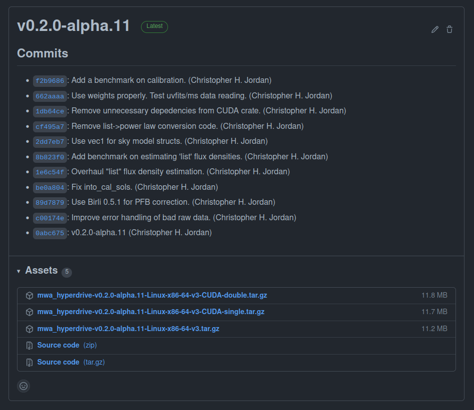

# Installing `hyperdrive` from pre-compiled binaries

Visit the [GitHub releases page](https://github.com/MWATelescope/mwa_hyperdrive/releases). You should see releases like the following:



- Under "Assets", download one of the `tar.gz` files starting with
  `mwa_hyperdrive`;
- Untar it (e.g. `tar -xvf mwa_hyperdrive*.tar.gz`); and
- Run the binary (`./hyperdrive`).

If you intend on running `hyperdrive` on a desktop GPU, then you probably want
the "CUDA-single" release. You can still use the double-precision version on a
desktop GPU, but it will be much slower than single-precision. Instructions to
install CUDA are on [the next page](from_source.md#cuda).

It is possible to run `hyperdrive` with HIP (i.e. the AMD equivalent to
NVIDIA's CUDA), but HIP does not appear to offer static libraries, so no static
feature is provided, and users will need to compile hyperdrive themselves with
instructions on [the next page](from_source.md#gpu).

~~~admonish
The pre-compiled binaries are made by GitHub actions using:
```shell
cargo build --profile production --locked --features=hdf5-static
```
"CUDA-double" binaries have the `cuda` feature and "CUDA-single" binaries have
the `cuda` and `gpu-single` features. CUDA cannot legally be statically linked
so a local installation of CUDA is required.
~~~

## Docker images

Each release is also published to Docker Hub as
[`mwatelescope/hyperdrive`](https://hub.docker.com/r/mwatelescope/hyperdrive),
built with the `bmetrics` feature:

| Tag | Platforms | GPU |
|-----|-----------|-----|
| `<version>-bmetrics`, `latest` | amd64, arm64 | none |
| `<version>-bmetrics-cuda12.5.1-ubuntu24.04` | amd64 | NVIDIA V100, A100 (`sm_70,80`) |
| `<version>-bmetrics-rocm6.3.3-ubuntu24.04` | amd64 | AMD MI250X (`gfx90a`, e.g. Setonix) |

Each tag also has a `<version>-bmetrics-<commit>` form pinned to a commit. For
example, with Singularity/Apptainer:

```shell
singularity pull docker://mwatelescope/hyperdrive:0.8.2-bmetrics-cuda12.5.1-ubuntu24.04
```

The entrypoint is `hyperdrive`, so arguments go straight to it; use
`--entrypoint bash` for a shell:

```shell
docker run --rm mwatelescope/hyperdrive:latest --version
```

To build other variants yourself, see the recipes at the top of the
[`Dockerfile`](https://github.com/MWATelescope/mwa_hyperdrive/blob/main/Dockerfile).
