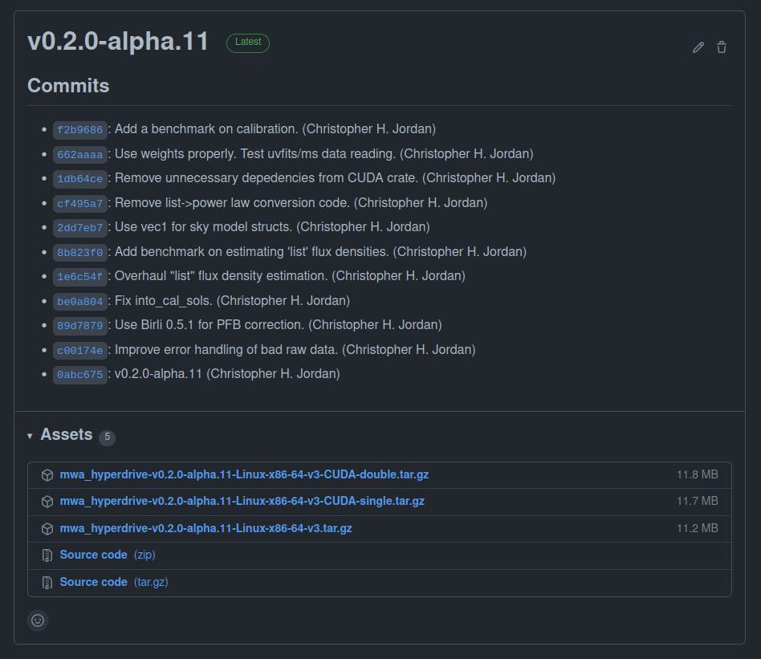

# Installing `hyperdrive` from pre-compiled binaries

Visit the [GitHub releases page](https://github.com/MWATelescope/mwa_hyperdrive/releases). You should see releases like the following:



- Under "Assets", download one of the `tar.gz` files starting with
  `mwa_hyperdrive`;
  - `x86-64-v2` and `x86-64-v3` in the file names are [microarchitecture
    levels](https://en.wikipedia.org/wiki/X86-64#Microarchitecture_levels).
    `v3` is faster but needs a CPU with AVX2 (most CPUs made since about
    2015); `v2` runs on older CPUs too.
- Untar it (e.g. `tar -xvf mwa_hyperdrive*.tar.gz`); and
- Run the binary (`./hyperdrive`).

If you intend on running `hyperdrive` on a desktop GPU, then you probably want
the "CUDA-single" release. You can still use the double-precision version on a
desktop GPU, but it will be much slower than single-precision. Instructions to
install CUDA are on [the next page](from_source.md#cuda).

It is possible to run `hyperdrive` with HIP (i.e. the AMD equivalent to
NVIDIA's CUDA), but no pre-compiled HIP binaries are provided; users will need
to compile `hyperdrive` themselves with the instructions on [the next
page](from_source.md).

~~~admonish
The pre-compiled binaries are made by GitHub actions using:
```shell
cargo build --profile production --locked --features=hdf5-static
```
"CUDA-double" binaries have the `cuda` feature and "CUDA-single" binaries have
the `cuda` and `gpu-single` features. CUDA cannot legally be statically linked
so a local installation of CUDA is required (the same major version as the one
named in the release's README).
~~~
