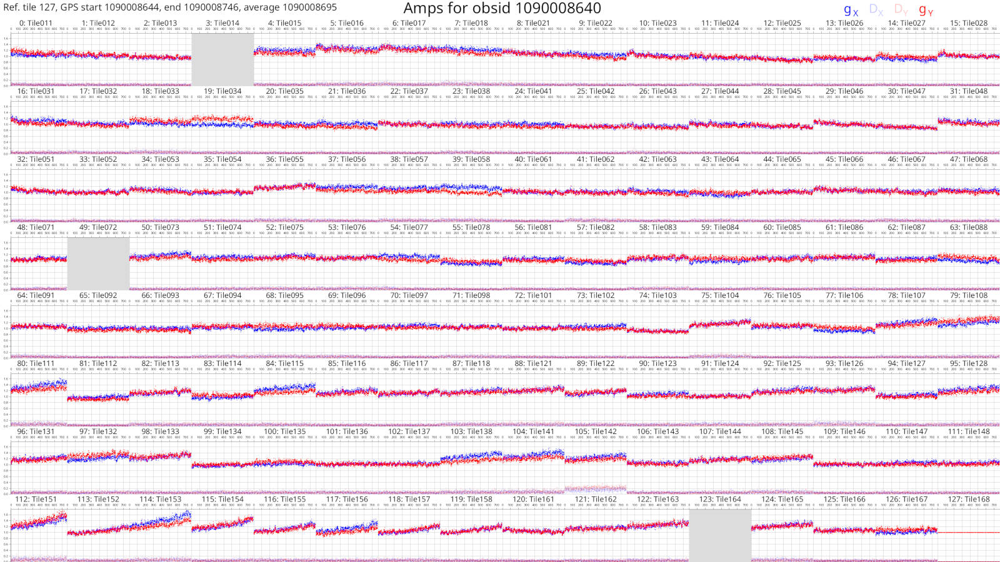
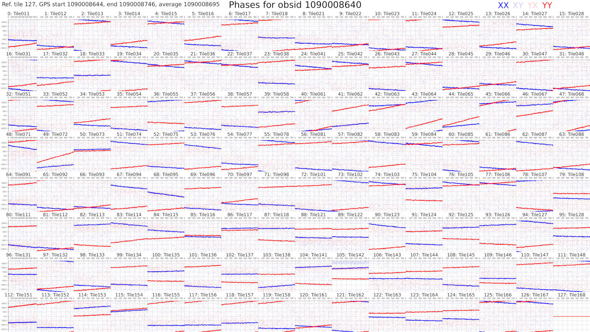

# Plot solutions

`hyperdrive` is capable of producing plots of calibration solutions for any of
its [supported file formats](../defs/cal_sols.md). Note that only
`hyperdrive`-formatted calibration solutions can contain tile names; when tile
names are unavailable, they won't be on the plots *unless* a corresponding
metafits file is provided. With or without tile names, an index is provided.

Calibration solutions are stored as corrections, i.e. the Jones matrices that
take the data to the model, and these are what `solutions-plot` plots. To plot
their inverses, which are the instrumental gains, use `--gains` (the plot
filenames then have a `_gains` suffix).

By default, a reference tile is selected and reported at the top left of the
plot. (By default, the last tile that isn't comprised of only NaNs is selected,
but this can be manually chosen.) It is also possible to neglect using any
reference tile. With a reference tile, each tile's solutions are divided by the
reference's solutions, and the resulting Jones matrix values are plotted (the
legend is indicated at the top right of each plot). \\( g_x \\) is the gain on a
tile's X polarisation and \\( g_y \\) is the gain on a tile's Y
polarisation. \\( D_x \\) and \\( D_y \\) are the leakage terms of those
polarisations.

By default, the y-axis of amplitude plots capture the entire range of values.
These plots can therefore be skewed by bad tiles; it is possible to control the
range by specifying `--max-amp` and `--min-amp`.

If a calibration solutions file contains multiple timeblocks, plots are produced
for each timeblock. Timeblock information is given at the top left, if
available.

## Example plots

### Amplitudes ("amps")



### Phases



# Plotting crosstalk scores

`hyperdrive crosstalk-plot` takes the per-baseline crosstalk scores that the
`crosstalk-qa` tool writes, one CSV per observation, and plots them over a whole
night so that persistent crosstalk stands out from noise. Each CSV needs `pol`,
`ant1`, `ant2` (tile names), `length_m`, `tau_peak_ns`, `t`, `z` and `flag`
columns; other columns are ignored. A metafits supplies each tile's receiver and
cable flavour.

```shell
hyperdrive crosstalk-plot xt-out/*.csv -m 1472670968.metafits -o plots/
```

Crosstalk on the MWA is mostly between tiles on the same receiver, so by default
tiles are grouped by receiver, and sorted by cable flavour within each receiver
(`--group-by receiver+flavour`; `receiver` and `flavour` are also available).
Tiles are always coloured by cable flavour, with the colours assigned to the
flavours in name order so that a flavour keeps its colour between runs.

Five figures are written, each with an XX and a YY panel. Tiles with no scored
baselines in any observation are left out.

- `crosstalk_tile_obs.png`: the number of flagged baselines touching each tile
  in each observation, in bins (0, 1, 2, 3-4, 5-8, 9-16, 17+), beside a strip of
  each tile's flavour. A tile that is a crosstalk source is a dark row through
  the night. Grey cells are observations in which the tile had no scored
  baselines.
- `crosstalk_tile_spread.png`: each tile's flag counts over the night (jittered,
  so that equal counts don't hide each other), with the median as a black bar;
  the worst tiles are labelled with their medians.
- `crosstalk_baseline_matrix.png`: the night's median z of every baseline, XX
  below the diagonal and YY above. Each receiver's own block is outlined, so a
  hot cell outside a block is a pair on different receivers.
- `crosstalk_z_vs_length.png`: z against baseline length for every baseline in
  every observation. Flagged points are coloured by their pair of flavours,
  circles for a pair of one flavour and triangles for mixed pairs. A persistent
  crosstalk baseline is a vertical stripe of flagged points; baselines flagged
  in at least half the observations are labelled. Rows with no delay peak
  (`t = 0`) are left out, as their z only reflects how little delay range was
  left to search.
- `crosstalk_peak_delay.png`: for the flagged baselines, z against the delay of
  the peak, and against how far the peak is past the foreground cut
  (\\( |b|/c \\) plus the search's buffer). Crosstalk through a fixed signal
  path keeps the same delay all night; a peak right at the cut may be foreground
  leakage instead.

The z threshold and the foreground buffer are read from the JSON that
`crosstalk-qa` writes next to each CSV; the threshold can be overridden with
`--z-min`. The outlier tiles and
baselines are also printed.
